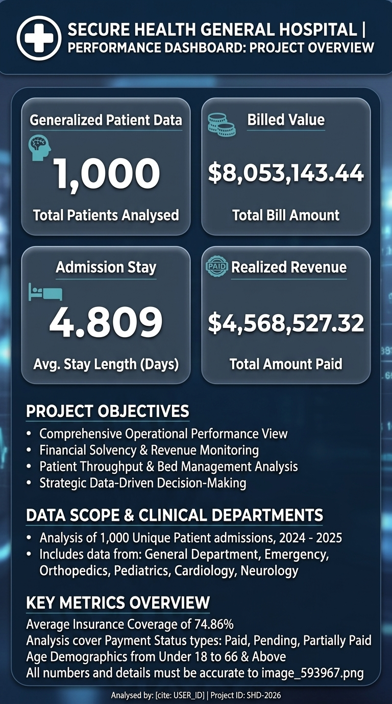
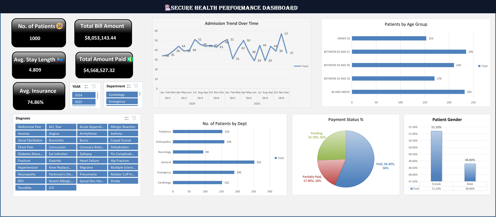

# SECURE HEALTH GENERAL HOSPITAL PERFORMANCE DASHBOARD

## I. Title
**SECURE HEALTH GENERAL HOSPITAL PERFORMANCE DASHBOARD**

---

## II. Introduction
The **Secure Health General Hospital Performance Dashboard** is an executive-level healthcare analytics solution designed to monitor clinical operations, patient intake dynamics, financial health, and department workload distribution. By synthesizing patient admission records into interactive key performance indicators (KPIs) and dynamic charts, this project provides hospital administrators with clear operational visibility to enhance revenue cycle management and optimize healthcare delivery.

---

## III. About the Dataset
The dataset captures 1,000 patient admission records across six clinical departments, detailing patient demographics, financial billing, insurance coverage, and diagnostic categories:
* **Total Patients:** 1,000 unique patient admissions
* **Total Billed Amount:** $8,053,143.44 total gross hospital charges
* **Total Amount Paid:** $4,568,527.32 total realized revenue collected
* **Average Insurance Coverage:** 74.86% insurance coverage rate
* **Average Length of Stay:** 4.809 days per patient stay
* **Key Dimensions:** Patient Age Groups, Gender, Clinical Department (General, Emergency, Orthopedics, Pediatrics, Cardiology, Neurology), Payment Status (Paid, Pending, Partially Paid), Diagnosis, and Admission Timelines (2024–2025).

---

## IV. Problem Statement
Secure Health General Hospital faced several key operational and financial challenges requiring data-driven intervention:
1. **Revenue Cycle Bottlenecks:** A significant portion of billed revenue remained uncollected or tied up in pending insurance/patient payments.
2. **Departmental Resource Imbalance:** Uneven distribution of patient admissions across clinical departments leading to overcrowding in specific units.
3. **Length of Stay Management:** Need to evaluate average patient stay duration (4.8 days) against diagnostic trends and bed turnover capacity.
4. **Demographic Care Targeting:** Incomplete visibility into high-utilization age demographics to optimize specialized medical staffing and equipment allocation.

---

## V. Visualization

### Dashboard Overview (`Dashboard_Image`)

---

## VI. Insights

### 1. Key Performance Indicators (KPIs)
* **Total Patients:** 1,000
* **Total Bill Amount:** $8,053,143.44
* **Total Amount Paid:** $4,568,527.32
* **Average Stay Length:** 4.809 Days
* **Average Insurance Coverage:** 74.86%

### 2. Financial & Payment Status Breakdown
* **Paid (Fully Settled):** **56.40%** (564 patients / $4.57M realized)
* **Pending Payments:** **25.70%** (257 patients / ~$2.07M uncollected)
* **Partially Paid:** **17.90%** (179 patients / ~$1.44M partial balance)
> **Key Finding:** **43.60%** of all hospital billing is currently uncollected or partially paid, representing a major financial recovery opportunity.

### 3. Departmental Workload Distribution
* **General Department:** **252 Patients** (25.2% of total workload - Highest volume)
* **Emergency Department:** **190 Patients** (19.0% - Urgent care demand)
* **Orthopedics:** **159 Patients** (15.9%)
* **Pediatrics:** **153 Patients** (15.3%)
* **Cardiology:** **152 Patients** (15.2%)
* **Neurology:** **94 Patients** (9.4% - Lowest volume)

### 4. Patient Demographics & Age Distribution
* **Gender Split:** 
  * Female: **51.20%** (512 patients)
  * Male: **48.80%** (488 patients)
* **Age Groups:**
  * **Between 51 & 65:** **235 Patients** (23.5% - Largest group)
  * **66 & Above:** **232 Patients** (23.2% - Second largest group)
  * **Between 36 & 50:** **210 Patients** (21.0%)
  * **Between 18 & 35:** **170 Patients** (17.0%)
  * **Under 18:** **153 Patients** (15.3%)
> **Key Finding:** Patients aged 51 and older represent **46.7%** of total hospital admissions.

### 5. Admission Trends Over Time (2024 – 2025)
* Admissions display consistent seasonal cycles, ranging between **29 to 57 admissions per month**.
* Peak volume was recorded in **Q4 2025 (57 admissions in late 2025)**, requiring scaled seasonal capacity planning.

---

## VII. Recommendation
1. **Implement Automated Revenue Recovery:** Focus immediate collections effort on the **25.70% pending payments** by establishing direct electronic claim tracking with insurance providers (capitalizing on the 74.86% average insurance coverage).
2. **Scale General & Emergency Staffing:** Reallocate clinical staff and bed capacity to the **General** (252 patients) and **Emergency** (190 patients) departments, which account for over 44% of total patient volume.
3. **Establish Senior & Geriatric Specialized Care Programs:** Since 46.7% of patients are aged 51+, tailor clinical pathways and rehabilitation services specifically for mature and senior patient groups.
4. **Optimize Length of Stay (LOS):** Review clinical care pathways for diagnoses exceeding the 4.8-day average to safely increase bed turnover without compromising care quality.

---

## VIII. Conclusion
The **Secure Health General Hospital Performance Dashboard** provides critical operational and financial intelligence. By transforming raw hospital metrics into strategic visual data, healthcare leaders can improve revenue collection pipelines, streamline emergency and ward workloads, and optimize care quality for all patient demographics.
